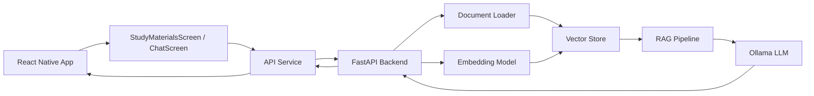

# Smart Study Buddy Native

Smart Study Buddy Native is a full-stack AI-powered study assistant built with React Native and a Python FastAPI backend. Add PDF or TXT study materials, then ask questions and get answers grounded in the indexed documents.

The backend uses local Hugging Face embeddings, a persistent local vector index, and Ollama for answer generation. Uploaded files and the generated index stay on the backend machine and are excluded from Git.

## Project goal

This project demonstrates how to build a practical study companion that:

- uploads PDF and TXT lecture notes from the app
- accepts a question from a mobile app or web app
- searches indexed study materials
- finds the best matching document chunks
- sends those chunks as context to an LLM
- returns a grounded answer with source references

## High-level architecture



At a high level:

- the mobile app sends user questions to the backend
- users upload PDF/TXT files and the backend indexes them
- the vector store retrieves similar passages
- Ollama generates an answer using the retrieved context
- the app shows the answer to the user

## Component breakdown

### 1. Mobile frontend

The frontend is a React Native application for Android and web. Users manage their materials on the study-materials screen, then switch to chat to ask questions about indexed content.

Key files:

- `App.tsx`
  Root entry point that navigates between study materials and chat.

- `src/screens/StudyMaterialsScreen.tsx`
  Lists indexed documents, supports PDF/TXT uploads and deletion, and reports indexing status.

- `src/screens/ChatScreen.tsx`
  Chat screen. It manages:
  - current session ID
  - message list
  - user input
  - loading state
  - sending requests to the backend
  - error handling
  - starting and clearing a chat

- `src/components/ChatInput.tsx`
  User input component for typing a question and sending it.

- `src/components/MessageBubble.tsx`
  Displays either user or assistant messages in the chat bubble UI.

- `src/components/DocumentCard.tsx`
  Displays a study material and its indexed chunk count.

- `src/services/api.ts`
  Shared HTTP client for chat, document listing, upload, and deletion.

- `src/config/api.ts`
  Selects the backend URL for web and native platforms.

- `src/picker/`
  Provides platform-specific PDF/TXT document pickers for native and web.

- `src/storage/chatStorage.ts`
  Stores chat history in local storage with AsyncStorage so previous messages remain available when the app is reopened.

- `src/theme/colors.ts`
  Centralizes color definitions for the chat UI theme.

- `src/types/chat.ts`
  Defines TypeScript models for chat messages and backend responses.

### 2. Backend API

The backend is a Python FastAPI service that initializes the RAG pipeline, serves the API, and keeps conversation context in memory per session.

Key files:

- `backend/server.py`
  Main API entry point. It contains:
  - FastAPI app setup
  - CORS middleware for local development
  - request validation models
  - in-memory session tracking
  - chat, health, document listing/upload/deletion, and session-history routes
  - initialization logic for the document store and RAG chain

- `backend/config.py`
  Reads backend configuration from environment variables such as the notes directory and model settings.

- `backend/loaders.py`
  Loads documents from the notes folder. It supports lecture files such as `.txt` and `.pdf` and prepares them for processing.

- `backend/embeddings.py`
  Creates the embedding model used to convert text into vector representations.

- `backend/vectorstore.py`
  Stores embeddings and document chunks in a persistent local index at `backend/data/rag_index.pkl` by default.

- `backend/rag.py`
  Creates the retrieval and generation workflow. This is the main logic that:
  - retrieves relevant passages
  - combines them with chat history
  - sends the final prompt to the language model
  - returns a grounded answer

### 3. Data and AI pipeline

The intelligence in the app comes from a retrieval-augmented generation workflow.

The backend pipeline works like this:

1. The notes directory is scanned for study material.
2. Documents are split into chunks.
3. Local Hugging Face embeddings are generated for each chunk.
4. Chunks and vectors are saved in the local persistent index.
5. A question is sent to the backend.
6. Similar note chunks are retrieved using vector similarity.
7. The retrieved context is passed to Ollama. Chat history provides conversational continuity, not evidence.
8. The model returns an answer based on the retrieved notes.
9. The response is returned to the mobile app.

The assistant is instructed to answer only from uploaded-document context. If the material does not support an answer, it returns a not-available response rather than relying on general knowledge.

## End-to-end request flow

```text
User adds PDF/TXT study material or types a question
        ↓
StudyMaterialsScreen uploads with POST /documents/upload
        ↓
FastAPI extracts text, chunks it, embeds it, and saves the local index
        ↓
ChatScreen sends POST /chat through src/services/api.ts
        ↓
FastAPI backend validates the request body
        ↓
RAG pipeline loads the relevant note chunks
        ↓
Local cosine similarity search finds the best matching passages
        ↓
Ollama generates a final answer using retrieved context
        ↓
Backend returns answer + source information
        ↓
Mobile app displays the assistant response in the chat
```

## Project structure

```text
SmartStudyBuddyNative/
├── App.tsx
├── src/
│   ├── components/
│   │   ├── ChatInput.tsx
│   │   ├── DocumentCard.tsx
│   │   └── MessageBubble.tsx
│   ├── screens/
│   │   ├── ChatScreen.tsx
│   │   └── StudyMaterialsScreen.tsx
│   ├── services/
│   │   └── api.ts
│   ├── config/
│   │   └── api.ts
│   ├── picker/
│   │   ├── FilePicker.tsx
│   │   └── FilePicker.web.tsx
│   ├── storage/
│   │   └── chatStorage.ts
│   ├── theme/
│   │   └── colors.ts
│   └── types/
│       └── chat.ts
├── backend/
│   ├── config.py
│   ├── embeddings.py
│   ├── loaders.py
│   ├── rag.py
│   ├── requirements.txt
│   ├── server.py
│   ├── vectorstore.py
│   └── input_lecture_notes/
├── android/
├── web/
├── package.json
├── package-lock.json
├── index.js
├── index.web.ts
└── README.md
```

`backend/data/` is created at runtime and contains uploaded files and the local vector index; it is intentionally not tracked.

## How the app stores chat state

The app keeps two different kinds of state:

- Frontend local storage
  Chat history is saved in AsyncStorage so it remains available when the app is reopened.

- Backend session memory
  The FastAPI service keeps conversation context in memory per session while the backend process is running. Restarting the backend clears this server-side context.

## Main technologies

### Frontend

- React Native
- TypeScript
- AsyncStorage
- React Native Web
- React Native Document Picker
- Fetch API

### Backend

- Python
- FastAPI
- Pydantic
- LangChain document loaders and text splitters
- Hugging Face `all-MiniLM-L6-v2` local embeddings
- NumPy-based local cosine-similarity vector store
- Ollama (default model: `llama3.2:3b`)

## Prerequisites

Before running the project, install:

- Node.js 20+
- npm
- Python 3.10+
- Ollama, with the configured chat model pulled locally
- Android Studio and Android SDK for Android builds
- A device/emulator or web browser for the frontend

## Setup and run

### 1. Install frontend dependencies

From the project root:

```bash
npm install
```

### 2. Install backend dependencies

From the project root:

```bash
python -m venv backend\.venv
backend\.venv\Scripts\Activate.ps1
python -m pip install -r backend\requirements.txt
```

On macOS/Linux, activate the environment with `source backend/.venv/bin/activate`.

### 3. Install and start Ollama

Install Ollama for your platform, then download the default model:

```bash
ollama pull llama3.2:3b
```

Keep Ollama running while using chat. The backend connects to `http://127.0.0.1:11434` by default.

### 4. Configure the backend (optional)

The backend works with defaults and does not require OpenAI or Pinecone credentials. To override defaults, create `backend\.env`, for example:

```env
OLLAMA_MODEL=llama3.2:3b
OLLAMA_BASE_URL=http://127.0.0.1:11434
EMBEDDING_MODEL=all-MiniLM-L6-v2
RETRIEVAL_K=4
MAX_UPLOAD_SIZE_MB=500
```

Upload PDF/TXT study files from the app. The `backend/input_lecture_notes` directory is retained in the repository but is not automatically indexed by the current API.

### 5. Start the backend

From the `backend` directory:

```bash
..\backend\.venv\Scripts\Activate.ps1
python -m uvicorn server:app --reload --host 0.0.0.0 --port 8000
```

The API is available at:

- `http://localhost:8000`
- Swagger docs: `http://localhost:8000/docs`
- Health check: `http://localhost:8000/health`

### 6. Start the app

From the root directory:

```bash
npm run web
```

For Android, start Metro in one terminal:

```bash
npm start
```

Then run the app from a second terminal:

```bash
npm run android
```

### Backend URL for Android

The platform-specific API URL is defined in `src/config/api.ts`. Web uses `127.0.0.1`; native currently uses a LAN address for local-device testing. Set the native URL to an address reachable from your device (for example, the development machine's LAN IP for a physical device or the Android emulator's host address). Ensure the device and backend can communicate over the network.

## API endpoints

The FastAPI service exposes:

| Method | Endpoint | Purpose |
| --- | --- | --- |
| `GET` | `/health` | Backend, RAG initialization, and indexed chunk status |
| `GET` | `/documents` | List indexed study materials |
| `POST` | `/documents/upload` | Upload and index a PDF or TXT file (`multipart/form-data`, field `file`) |
| `DELETE` | `/documents/{document_id}` | Delete a material and its indexed chunks |
| `POST` | `/chat` | Ask a question (`session_id` and `message` JSON fields) |
| `GET` | `/history/{session_id}` | Read the current in-memory backend chat history |
| `DELETE` | `/history/{session_id}` | Clear the current in-memory backend chat history |

## Typical usage

1. Start Ollama and the FastAPI backend.
2. Open the app and upload one or more PDF/TXT files.
3. Wait for the upload status to confirm indexing.
4. Select **Start studying** and ask questions in chat.
5. Review the answer and source references; unsupported questions return a not-available response.

Documents are listed from the backend's vector index. Deleting a document removes its indexed chunks and corresponding uploaded file.

## Why this architecture works

This project separates responsibilities cleanly:

- the frontend is responsible for user interaction
- the API server handles requests and orchestration
- the document loader prepares study material
- the embeddings model converts content into searchable vectors
- the vector store performs semantic search
- the language model answers from the retrieved knowledge

This separation leaves room to expand with features like:

- user authentication
- persistent backend conversation storage
- richer course analytics
- OCR for image-only PDFs
- PDF parsing improvements

## Troubleshooting

### App can't connect to the backend

Check that:

- the FastAPI server is running
- the API URL in `src/config/api.ts` matches the backend host
- the Android emulator or device can reach the development machine over the network

### Ollama connection or model errors

- Make sure Ollama is running and `ollama pull llama3.2:3b` (or your configured model) completed.
- If Ollama is running on a different host or port, set `OLLAMA_BASE_URL` in `backend\.env`.

### Upload errors or missing materials

- Only PDF and TXT files are accepted; the upload size limit defaults to 500 MB and can be changed with `MAX_UPLOAD_SIZE_MB`.
- Check `http://localhost:8000/health` for backend initialization status and `http://localhost:8000/docs` for API details.
- Uploaded files and the vector index are stored under `backend/data` by default. This folder is ignored by Git; deleting it removes locally stored uploaded materials and index data.

### Answers say content is unavailable

- Confirm the material appears in the app's study-materials list and has indexed chunks.
- Image-only/scanned PDFs may not contain extractable text; OCR is not currently included.
- The RAG pipeline filters low-similarity matches and only answers from retrieved document context.
