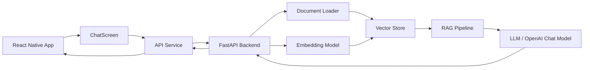

# Smart Study Buddy Native

Smart Study Buddy Native is a full-stack AI-powered study assistant built for mobile learners. It combines a React Native frontend with a Python FastAPI backend and a retrieval-augmented generation (RAG) pipeline to answer questions from uploaded lecture notes.

The app is designed to help students ask questions about their course material and get grounded answers based on the actual content in their notes instead of generic internet knowledge.

## Project goal

This project demonstrates how to build a practical study companion that:

- accepts a question from a mobile app
- searches relevant lecture notes
- finds the best matching document chunks
- sends those chunks as context to an LLM
- returns a grounded answer with source references

## High-level architecture



At a high level:

- the mobile app sends user questions to the backend
- the backend loads and indexes notes
- the vector store retrieves similar passages
- the LLM generates an answer using the retrieved context
- the app shows the answer to the user

## Component breakdown

### 1. Mobile frontend

The frontend is a React Native application used to power the chat experience on Android and web. It handles the UI, local state, message composition, and network requests to the backend.

Key files:

- `App.tsx`  
  Root app entry point. It renders the main chat screen and applies the app status bar.

- `src/screens/ChatScreen.tsx`  
  Main screen for the study assistant. It manages:
  - current session ID
  - message list
  - user input
  - loading state
  - sending requests to the backend
  - error handling
  - creating a new chat or clearing chat history

- `src/components/ChatInput.tsx`  
  User input component for typing a question and sending it.

- `src/components/MessageBubble.tsx`  
  Displays either user or assistant messages in the chat bubble UI.

- `src/services/api.ts`  
  Shared API layer for all backend calls. It exposes functions such as:
  - `sendMessage()`
  - `getHistory()`
  - `clearHistory()`
  - `healthCheck()`
  This file is responsible for HTTP communication with the FastAPI server.

- `src/storage/chatStorage.ts`  
  Stores chat history in local storage with AsyncStorage so previous messages remain available when the app is reopened.

- `src/theme/colors.ts`  
  Centralizes color definitions for the chat UI theme.

- `src/types/chat.ts`  
  Defines TypeScript models for chat messages and backend responses.

### 2. Backend API

The backend is a Python FastAPI service that acts as the brain of the system. It initializes the RAG pipeline, serves HTTP endpoints, and keeps conversation state in memory for each session.

Key files:

- `backend/server.py`  
  Main API entry point. It contains:
  - FastAPI app setup
  - CORS middleware for local development
  - request validation models
  - in-memory session tracking
  - `/chat`, `/health`, and `/history/{session_id}` routes
  - initialization logic for the document store and RAG chain

- `backend/config.py`  
  Reads backend configuration from environment variables such as the notes directory and model settings.

- `backend/loaders.py`  
  Loads documents from the notes folder. It supports lecture files such as `.txt` and `.pdf` and prepares them for processing.

- `backend/embeddings.py`  
  Creates the embedding model used to convert text into vector representations.

- `backend/vectorstore.py`  
  Builds or reuses a vector database index and stores note chunks for semantic search. In this project, Pinecone is used as the vector datastore.

- `backend/rag.py`  
  Creates the retrieval and generation workflow. This is the main logic that:
  - retrieves relevant passages
  - combines them with chat history
  - sends the final prompt to the language model
  - returns a grounded answer

### 3. Data and AI pipeline

The intelligence in the app comes from a retrieval-augmented generation workflow.

The backend pipeline works like this:

1. The notes directory is scanned for study material.
2. Documents are split into chunks.
3. Embeddings are generated for each chunk.
4. Chunks are stored in a vector database.
5. A question is sent to the backend.
6. Similar note chunks are retrieved using vector similarity.
7. The retrieved context is passed to the LLM together with the chat history.
8. The model returns an answer based on the notes.
9. The response is returned to the mobile app.

This is the core of the project: the assistant does not rely only on the model's general knowledge; it grounds its answers in the user's uploaded study material.

## End-to-end request flow

```text
User types a question in the mobile app
        ↓
ChatScreen validates input and calls sendMessage()
        ↓
src/services/api.ts sends POST /chat to the backend
        ↓
FastAPI backend validates the request body
        ↓
RAG pipeline loads the relevant note chunks
        ↓
Vector similarity search finds the best matching passages
        ↓
LLM generates a final answer using retrieved context
        ↓
Backend returns answer + source information
        ↓
Mobile app displays the assistant response in the chat
```

## Project structure

```text
SmartStudyBuddyNative/
├── App.tsx
├── src/
│   ├── components/
│   │   ├── ChatInput.tsx
│   │   └── MessageBubble.tsx
│   ├── screens/
│   │   └── ChatScreen.tsx
│   ├── services/
│   │   └── api.ts
│   ├── storage/
│   │   └── chatStorage.ts
│   ├── theme/
│   │   └── colors.ts
│   └── types/
│       └── chat.ts
├── backend/
│   ├── config.py
│   ├── embeddings.py
│   ├── loaders.py
│   ├── rag.py
│   ├── requirements.txt
│   ├── server.py
│   ├── vectorstore.py
│   └── input_lecture_notes/
├── android/
├── babel.config.js
├── jest.config.js
├── metro.config.js
├── package.json
├── tsconfig.json
├── README.md
├── index.js
├── index.web.ts
├── web/
├── app.json
├── Gemfile
├── .gitignore
├── .eslintrc.js
├── .prettierrc.js
├── .watchmanconfig
├── node_modules/
└── package-lock.json
```

## How the app stores chat state

The app keeps two different kinds of state:

- Frontend local storage  
  Chat history is saved in AsyncStorage so the app can reopen conversations later.

- Backend session memory  
  The FastAPI service keeps a lightweight in-memory conversation history for each session ID. This supports short-term chat context during the server session.

## Main technologies

### Frontend

- React Native
- TypeScript
- AsyncStorage
- Fetch API

### Backend

- Python
- FastAPI
- Pydantic
- LangChain / retrieval flow
- OpenAI embeddings and chat model
- Pinecone vector database

## Prerequisites

Before running the project, install:

- Node.js 20+
- npm
- Python 3.10+
- Android Studio and Android SDK for Android builds
- OpenAI API access
- Pinecone access if using the vector store

## Setup and run

### 1. Install frontend dependencies

From the project root:

```bash
npm install
```

### 2. Install backend dependencies

From the `backend` folder:

```bash
python -m venv .venv
source .venv/bin/activate    # macOS/Linux
# or .venv\Scripts\activate # Windows
pip install -r requirements.txt
```

### 3. Configure environment variables

Create a `.env` file inside the `backend` directory with values similar to:

```env
OPENAI_API_KEY=your_openai_key
CHAT_MODEL=gpt-4o-mini
USE_OPENAI_EMBEDDINGS=true
EMBEDDING_MODEL=text-embedding-3-small
PINECONE_API_KEY=your_pinecone_key
PINECONE_INDEX_NAME=smart-study-buddy
PINECONE_CLOUD=aws
PINECONE_REGION=us-east-1
NOTES_DIR=input_lecture_notes
RETRIEVAL_K=3
```

If you want to use local embeddings instead of OpenAI embeddings, set:

```env
USE_OPENAI_EMBEDDINGS=false
EMBEDDING_MODEL=all-MiniLM-L6-v2
```

### 4. Add your lecture notes

Place your `.txt` and `.pdf` files in the `backend/input_lecture_notes` folder.

### 5. Start the backend

From the `backend` directory:

```bash
uvicorn server:app --reload --host 0.0.0.0 --port 8000
```

This starts the API service at:

- `http://localhost:8000`
- Swagger docs: `http://localhost:8000/docs`

### 6. Start the mobile app

From the root directory:

```bash
npm start
```

Then in a second terminal:

```bash
npm run android
```

### Android device note

If the app is running on a physical device, update the backend URL in `src/services/api.ts` so it matches your machine's local network IP. The default configuration is meant for local testing.

## Typical usage

1. Launch the backend.
2. Add study notes to the notes folder.
3. Start the React Native app.
4. Ask a question in the chat box.
5. Review the grounded answer produced from the uploaded course material.

## Why this architecture works

This project separates responsibilities cleanly:

- the frontend is responsible for user interaction
- the API server handles requests and orchestration
- the document loader prepares study material
- the embeddings model converts content into searchable vectors
- the vector store performs semantic search
- the language model answers from the retrieved knowledge

This separation makes the system easier to expand with features like:

- note upload from the app
- user authentication
- persistent conversation storage
- richer course analytics
- multi-document support
- PDF parsing improvements

## Troubleshooting

### Backend can't connect

Check that:

- the FastAPI server is running
- the API URL in `src/services/api.ts` matches the backend host
- the Android emulator or device can reach the development machine over the network

### Empty or poor answers

Check that:

- the notes folder contains readable documents
- environment variables are configured correctly
- the OpenAI key is valid
- the Pinecone index is reachable and active

### Missing API keys

If the backend errors because of missing credentials, update the `.env` file in the `backend` folder with the required values.

## Summary

Smart Study Buddy Native is a practical example of an AI-powered study companion that uses mobile-first access, a FastAPI backend, and a retrieval-augmented generation pipeline to turn course notes into a helpful learning assistant.

It is a strong starting point for building more advanced educational tools with semantic search, personalization, and deeper study workflows.
